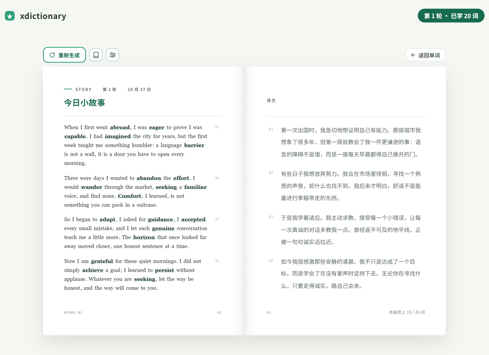
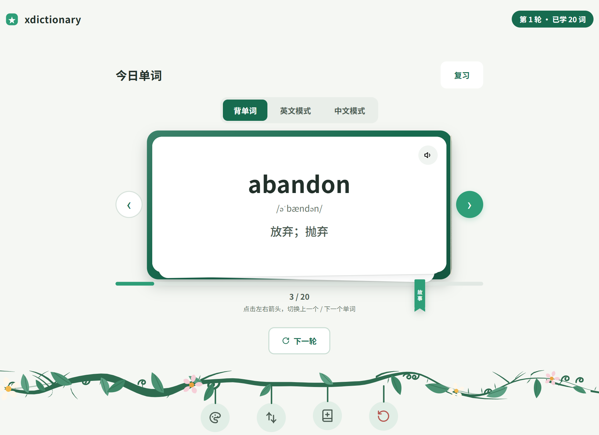
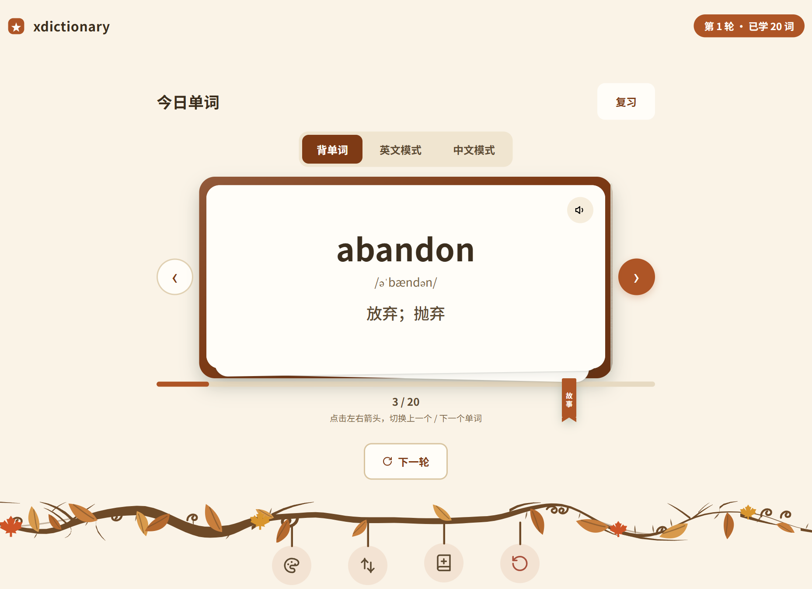
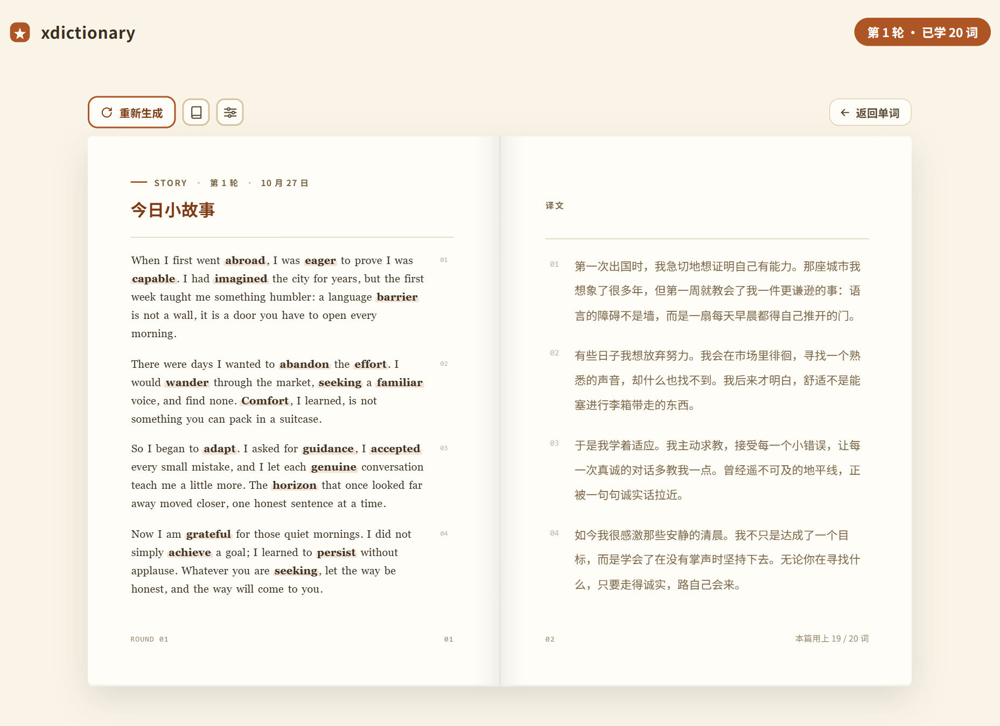

<div align="center">

# xdictionary

**每天 20 个四级高频词，用一篇小故事串起来。**

零依赖 · 纯静态 · 本地优先 —— 没有框架、没有构建步骤、没有后端。

[**在线试用**](https://fenghua-xueyue.github.io/xdictionary/) · [功能](#功能) · [设计取舍](#几个刻意的取舍) · [已知限制](#已知限制)

</div>

<p align="center">
  
  
</p>

## 这是什么

一个给自己用的背单词工具。它只做一件事，但做得比较彻底：

**把当天抽到的 20 个词，串成一篇中英对照的小故事。**

单词表记不住，是因为词是孤立的。放进句子里、放进一个语境里，记住的是"这个词在这个场景下怎么用"，而不是一行中文对应词。所以这里每天抽 20 个词，用它们写一篇短文 —— 左页英文，右页译文，篇里用到的词加粗。点卡片上的任意一个词，可以直接跳到故事里出现它的那一句。

故事不预置、不共享，由你自己的浏览器直连 AI 生成，因此每一轮都是新的。

## 功能

**学习**

- **300 个四级高频词**内置词库，每轮 20 词，15 轮抽完自动循环，跨轮不重复
- **三种模式**：背单词（完整卡）／ 英文模式（藏起释义）／ 中文模式（藏起英文，自测默写）
- **复习模式**按批次回看已学的词；**标记模式**只看自己标过的重点词
- **回到某一轮**：误触「下一轮」跳过的 20 词能退回去学完，没生成故事的旧轮也能补写（退的是那一轮本身，不是只读翻看）
- **点读发音**：点卡片右上角喇叭，用浏览器原生 TTS 朗读（优先 en-US）

**故事**

- 一键生成本轮故事，流式输出，边写边显示
- 摊开的书本视图：左英文右中文，四段，段号对齐，方便左右对照
- **故事集做成了一个书架**：每篇故事是一本书脊，一排 6 本可翻页，最多存 200 篇。点开哪本，书桌上就摊开哪本
- 看旧故事时页眉显示它自己那一轮的日期与轮次，主按钮变成「回到本轮」，不会误覆盖当前进度

**数据**

- **备份**：进度 / 标记 / 皮肤 / 故事集 / 自定义词库 / 手填释义 / 墨水瓶整包导出成一个 JSON，导入时先自动另存一份当前进度再覆盖。**API Key 不在备份文件里**
- **加词**：导入自己的词库（txt / csv / md 文档，或直接粘贴），自动与已有词去重并标出「已有」
- 进度、标记、故事全部存在浏览器本地，刷新、关浏览器都不丢

**外观**

- 两套皮肤：**春**（默认，初春新绿）／ **秋**（秋叶暖色，护眼耐看）
- 换肤有过渡动效；系统开启「减少动态效果」时自动全部关掉

<p align="center">
  
  
</p>

## 怎么用

### 在线用

打开 <https://fenghua-xueyue.github.io/xdictionary/> 即可，不用注册、不用安装。

单词卡的所有功能开箱可用。**AI 故事需要你自己填一个 DeepSeek API Key**（右上角齿轮），没有 Key 时点生成会提示去填，其他功能不受影响。

### 本地跑

```bash
git clone https://github.com/fenghua-xueyue/xdictionary.git
```

然后**双击 `index.html`**。就这样，没有 `npm install`，没有 dev server。

### 关于那个 API Key

- Key 只存在你自己浏览器的 `localStorage` 里，**不会发往除 DeepSeek 之外的任何地方**，作者也拿不到
- 故事请求由你的浏览器直接发往 `api.deepseek.com`，没有中转服务器
- 备份文件不包含 Key，换设备后到设置里重新填一次
- 费用按 DeepSeek 官方定价计，每篇故事几千 token 量级，具体以[官网](https://platform.deepseek.com/)为准

## 几个刻意的取舍

这个项目没有用任何框架，也没有走"现代前端"的常规路子，每一处都是有原因的：

**为什么零依赖。** 目标是一个断网也能用、拷贝到 U 盘就能跑、五年后打开还是好的工具。引入构建链意味着它迟早会因为某个依赖升级而跑不起来。现在它只有一个 `git clone` 和一次双击。

**为什么词库是 `window.WORDS` 而不是 JSON + fetch。** `file://` 协议下 `fetch` 一个本地 JSON 会被 CORS 拦掉。用 `<script>` 挂全局变量是唯一能让"双击 HTML"和"线上访问"共用同一套代码的写法。这是妥协，但换来的是零门槛。

**为什么数据只在 `localStorage`。** 上云就要账号、要后端、要处理隐私，而这只是个背单词工具。代价是设备之间不同步 —— 所以做了整包备份，让"搬家"是一件手动但确定的事。

**为什么颜色全走 CSS 变量。** 换肤是覆盖变量，不是替换样式表。组件区不写死色值，加一套新皮肤只需要在 `skin.js` 的登记表里加一行。

**为什么不改存储键名。** 六个 `localStorage` 键是数据的唯一容器，改名等于清空所有人的进度。它们是契约的一部分。

## 项目结构

```
index.html      首页（双窗橱窗，入口）
study.html      学习页 / 复习页 / 标记页 + 故事书 + 全部弹窗
style.css       设计系统、组件样式、皮肤定义
app.js          核心状态：抽词游标、翻卡、模式、标记、复习、书桌开合
story.js        AI 故事：流式请求、书页排版、故事集书架
bank.js         加词：导入自定义词库
backup.js       备份：六个键整包导出 / 导入
skin.js         换肤
intro.js        动效调度：页面入场、换肤过场、翻页动效
speak.js        点读发音（TTS）
words.js        300 词词库（window.WORDS）
```

技术栈就是原生 HTML / CSS / JavaScript。没有 `node_modules`，没有打包产物，改完刷新就生效。

## 已知限制

写在这里，免得你试的时候以为是 bug：

- **以桌面端为主。** 手机端布局还在改进中，窄屏下首页按钮位置和卡片留白都还不理想。手机上能用，但还不到"好用"
- **没有云同步。** 电脑和手机各存各的，进度不互通。想搬家就用备份导出、导入
- **故事依赖 DeepSeek**，换了别家服务商要改 `story.js` 里的接口地址
- **发音依赖系统语音包。** Windows 通常自带 en-US 语音；没有的话点喇叭会提示「未找到英文语音」，不影响其他功能
- **词库是 300 个通用四级高频词**，不是按个人薄弱点定制的。词不够用就自己加

## License

[MIT](LICENSE) —— 随便用、随便改、随便拿去改成自己的。
